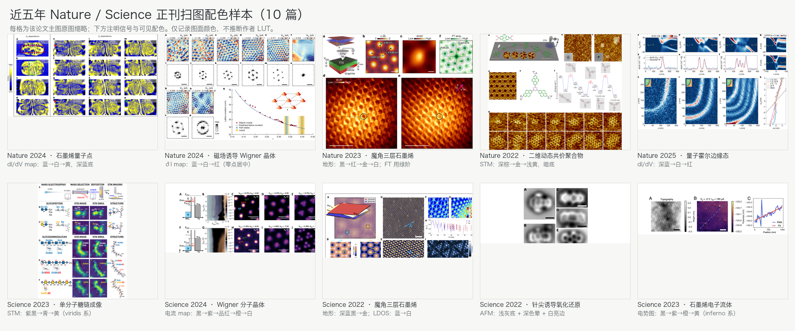
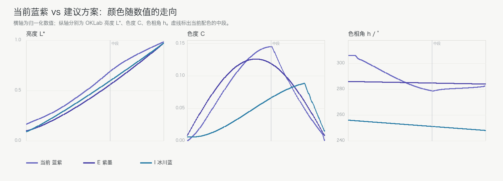
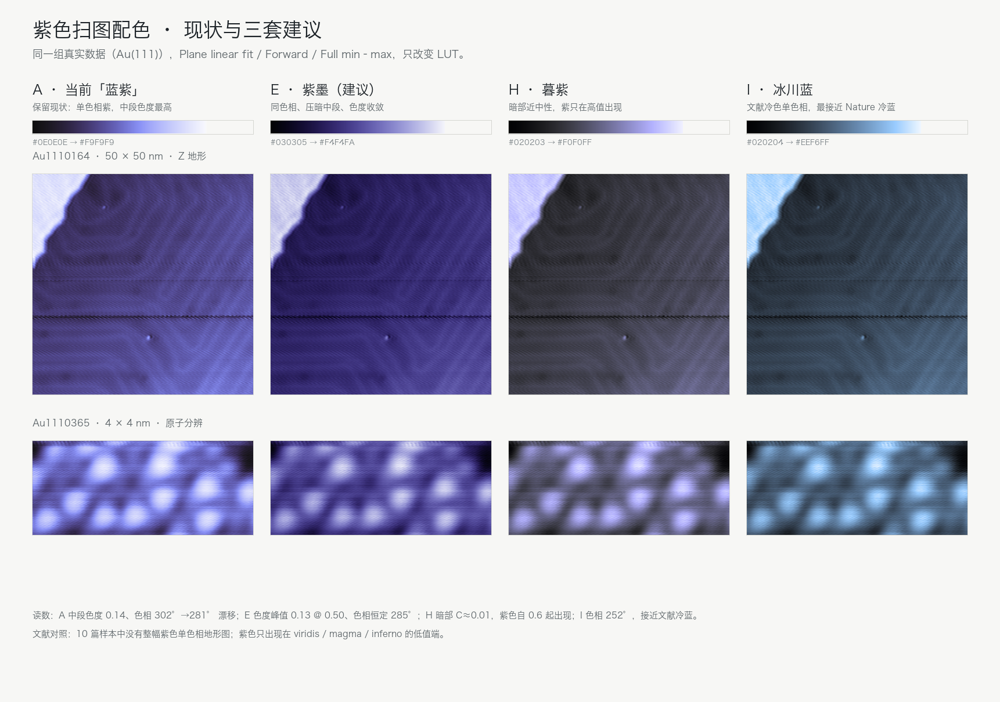

# 紫色扫图配色：Nature / Science 近作调研与改色建议

日期：2026-11-04 · 对象：SXM Browser 默认 STM 配色「Blue Violet」 · 样本：10 篇正刊研究论文（2022–2025）

---

## 0. 结论先行

1. **十篇里没有一篇把"紫色单色相"当作整幅地形的配色。** 紫色只以**低值端**出现在多色相图中（viridis 的 `#440154`、magma 的深紫、inferno 的紫黑）。整幅单色相的地形图用的是**冷蓝**或**暖金**，原子分辨 AFM 则基本是**灰阶 + 浅灰背景**。
2. 你现在的蓝紫不是"太艳"那么简单：它同时是**单色相**、**中段色度最高**（OKLCh C≈0.145，正好落在数据最密集的区间）、**色相从约 302° 漂到 281°**。三者叠加，大面积台面被涂成一层紫雾，读图时颜色变化会和亮度变化抢注意力。
3. 建议按改动幅度分三档：**E 紫墨**（保留紫相，只修明度与色相，可直接替换 `blueViolet` 的 stops）、**H 暮紫**（暗部近中性、紫色只在高值出现，最接近文献用法）、**I 冰川蓝**（换成文献验证过的冷蓝单色相）。三套 LUT 都已生成并验证，见 `palettes/`。



---

## 1. 调研范围与方法

- **样本**：Nature 5 篇、Science 5 篇，均为正刊 Research Article，2022–2025 年；选取标准是主图包含实空间 STM/AFM 扫描图（地形、dI/dV map、Δf 图、电流 map）。
- **读图方式**：Nature 论文读取出版社官方 figure 图（`media.springernature.com`，1200 px 宽）；Science 论文读取作者稿 / PMC 版（个别图与最终排版可能有细微差异，已在表中注明）。逐图记录色相家族、背景明暗、端点、是否给出色条及其数值范围。
- **不做的事**：不反推作者的 LUT 定义、gamma 或百分位裁剪。出版社从不公布这些，图上能看到的只是最终颜色。
- **抽样性质**：目的性抽样，用来观察"高水平论文怎么用颜色"，不是期刊层面的统计估计。

## 2. 十篇的扫图配色

| # | 论文 | 图 / 信号 | 扫描图配色 | 色条与端点 | 关键观察 |
|---|---|---|---|---|---|
| 1 | Ge et al., *Nature* **635**, 841 (2024)，石墨烯量子点中的相对论量子疤痕 | Fig. 1d、Fig. 2a–p：dI/dV_S map | 深蓝 → 亮蓝 → 白 → 黄，双色相、高色度 | 深蓝底；Fig. 1d 有 Low–High 渐变条；Fig. 1e/f 的 d²I/dV² 另用**红–白–蓝发散**条 | 色相随数值变化，疤痕条纹用黄白跳出；若换成单色相，条纹会和背景糊在一起 |
| 2 | Tsui et al., *Nature* **628**, 287 (2024)，磁场诱导 Wigner 晶体 | Fig. 2a–h：δI_dc map；i–p：FFT | 蓝 → 白 → 红（零点居中）；FFT 用灰阶 | 有 pA 数值色条 | 有符号量用发散色；实空间与倒空间分工明确 |
| 3 | Kim et al., *Nature* **623**, 942 (2023)，魔角三层石墨烯谷间相干 | Fig. 1b–e：z(Å)、dI/dV；f：FT | 黑 → 暗红 → 橙 → 金 → 白（暖单色相）；FT 用白 → 绿 | z 条 0–2 Å；dI/dV 为 Low–High 条 | 暖金是"扫描图"的默认语汇；绿色只给傅里叶变换，避免和形貌混色 |
| 4 | Zhan et al., *Nature* **603**, 835 (2022)，二维动态共价聚合物 | Fig. 1b–d、g：STM | 深棕黑 → 金 → 浅黄白 | 无显式色条，仅比例尺 | 大面积暗背景 + 明亮分子；色相几乎不变，层次全靠亮度 |
| 5 | Yu et al., *Nature* **648**, 585 (2025)，量子霍尔边缘态 | Fig. 2a–c、g–j：dI/dV | 深蓝 → 白 → 红（0 → Max 顺序，不是发散） | 明确 0 / Max 色条 | 冷色为主、红只给最高值；深蓝底让白色边缘态跳出来 |
| 6 | Anggara et al., *Science* **382**, 219 (2023)，单分子糖链 | Fig. 1B–F：STM 与模拟 | 紫黑 → 蓝绿 → 黄（viridis 系） | 无逐图色条 | 紫色只做低值端；黄绿负责勾出糖链轮廓 |
| 7 | Li et al., *Science* **385**, 86 (2024)，Wigner 分子晶体 | Fig. 2C–E、H–J：隧穿电流 map | 黑 → 深紫 → 品红 → 橙 → 白（magma 系） | 无逐图色条 | 紫／品红是低中端，白只留给核心 |
| 8 | Turkel et al., *Science* **376**, 193 (2022)，魔角三层石墨烯的有序无序 | Fig. 1D–I：地形、LDOS、twist angle | 地形深蓝黑 + 金点；LDOS 深蓝 → 白；角度图蓝-绿-红 | Low–High 条 | 同一篇里三种编码：形貌暖色、LDOS 冷色、角度多色相 |
| 9 | Albrecht et al., *Science* **377**, 298 (2022)，针尖诱导氧化还原 | Fig. 2A–E：AFM | 灰阶，**浅灰背景** + 深色晕 + 白亮边 | 无 | 键分辨 AFM 用灰阶和浅底，不用彩色 |
| 10 | Krebs et al., *Science* **379**, 671 (2023)，石墨烯电子流体 | Fig. 2A、B：地形与电势 | 地形灰阶；电势黑 → 紫 → 橙 → 黄（inferno 系） | 电势条 −125.2 … −123.3 mV | 灰阶给形貌，彩色给物理量；紫色又是低端 |

> 第 6–10 篇读的是作者稿 / PMC 版；第 1–5 篇为出版社原图。表中颜色均按图面像素记录。

## 3. 横向规律

**R1｜彩色是给"物理量"的，不是给形貌的。** 十篇里出现高色度的地方（1、2、5、7、10）全是 dI/dV、δI、电流、电势这类 map；纯地形多数是暖金（3、4）或灰阶（9、10），冷蓝只在 LDOS（8）上出现。颜色越浓，越应该对应"这张图在讲一个量"。

**R2｜紫色几乎总是低值端。** viridis 的起点、magma 的深紫、inferno 的紫黑都是"暗部带一点紫"。没有任何一篇用紫→浅紫→白贯穿整个量程去做地形。这是本次调研最直接的一条对照。

**R3｜单色相时，色相基本不动。** 3、4 的暖金系、10 的 inferno 系、8 的 LDOS 冷蓝，色相要么恒定，要么只在很窄的范围内偏移；变化主要交给亮度。

**R4｜发散色严格留给有符号量。** 2 的 δI 有正负、1e/f 的 d²I/dV² 有正负，才用蓝–白–红；5 的 dI/dV 只有正值，即便是蓝–白–红，色条也写成 0 → Max 而不是 −/+，属于"顺序色"而非真发散。

**R5｜背景普遍深，AFM 例外。** STM 图几乎都是深色背景（黑、深蓝、深棕），高值才亮；键分辨 AFM（9）反过来用浅灰背景，因为力信号的对比方向与地形不同。

**R6｜色条几乎必有，LUT 定义几乎不写。** 十篇里多数给出 Low–High 渐变条或数值条，但没有一篇写出色相映射函数、gamma 或裁剪百分位。这说明：**读者只能看到最终颜色，作者必须让颜色自身可解释**。

## 4. 现配色的诊断



对 `blueViolet` 的 257 个 stops 做 OKLab/OKLCh 分析：

| 指标 | 当前值 | 含义 |
|---|---|---|
| 色相（t=0.1→0.9） | 约 302° → 281°（漂移 ≈20°） | 暗部偏紫红、亮部偏蓝紫；"变亮"同时"变蓝"，产生雾感 |
| 色度峰值 | C≈0.145，位于 t=0.61 | 峰值紧贴数据主体区间的上沿（台面多在 t 0.35–0.55） |
| 中段亮度 | L*≈0.56（t=0.5） | 中段偏亮，与高色度叠加成"粉紫"而非"深紫" |
| 高色度区间 | C>0.10 覆盖 t≈0.34–0.72，占 37% 量程 | 三分之一量程在"染色"，而数据恰好落在这段里 |
| 端点 | `#0E0E0E` → `#F9F9F9` | 亮点近纯白、暗点近纯灰，两端都没有冷调，和中间的紫脱节 |
| 图像实测 | 47% 像素 C>0.10；色相展布仅 4° | 大面积、单色相、高色度——这正是"滤镜感"的三个条件 |

**具体后果：**

- **台面被当成"背景色"染掉。** Au(111) 大片台面的高度差很小，全幅 min–max 后集中在 t≈0.29–0.49（第二张图到 0.76），正好落在 C 0.09–0.14 这一段。于是整幅图是紫的，结构对比只能靠紫的深浅去分辨。
- **色相漂移掩盖亮度。** 从暗到亮，眼睛先看到"紫 → 蓝紫"的色变，再看到明暗，这在噪声大的扫描线上尤其明显（斜向条纹会被读成颜色条纹）。
- **两端与中间脱节。** 高光走到 `#F9F9F9`（近纯白、已无色相），暗端停在 `#0E0E0E`（近中性灰），只有中间一大段是紫的；最亮与最暗的像素都不再携带紫色信息。
- **和文献习惯相反。** 文献里紫色是"暗端的一点冷"，你是"整幅的紫"；文献里高色度对应特征，你是高色度对应大面积。

需要说明：**问题不是"紫色不能用"**。单色相冷色（5、8）完全成立；问题在于"单色相 + 中段高色度 + 大面积"这三件事同时发生。

## 5. 三套可选方案



| | E · 紫墨（建议默认） | H · 暮紫（判读模式） | I · 冰川蓝（论文风格） |
|---|---|---|---|
| 色相 | 286° 恒定（跨度 1.6°） | 287° 恒定 | 252° 恒定 |
| 亮度 | L* 0.10 → 0.97，中段压到 0.45 | L* 0.09 → 0.96，暗部近中性 | L* 0.09 → 0.97 |
| 色度 | 峰值 0.126 @ t=0.50 | 暗部 C≈0.01，t>0.6 才出现紫，峰值 0.108 @ 0.83 | 峰值 0.089 @ 0.86 |
| 端点 | `#030305` → `#F4F4FA` | `#020203` → `#F0F0FF` | `#020204` → `#EEF6FF` |
| 观感 | 深紫、层次清楚，保留品牌色 | 近炭黑 + 紫色高光，最像文献 map | 冷蓝白，最接近第 5、8 篇 |
| 适用 | 日常浏览、默认配色 | 噪声大、要判断细微高低差 | 出图、投稿、与文献并排 |

**E 紫墨**：只做三件事——把色相钉死在 286°、把中段亮度从 0.56 压到 0.45、把高光从纯白改成冷白。色度峰值只降了约 13%，但因为中段变暗，紫从"粉紫"回到"深紫"，台面与台阶的明暗差被拉开。改动最小，`blueViolet` 的 stops 直接替换即可，枚举和 UI 都不用动。

**H 暮紫**：把"紫色只做低值端"这条文献规律直接搬过来。t<0.45 基本是中性炭黑，紫从 0.6 之后才出现，最亮处是淡紫白。它的好处是**大面积背景不再染色**，噪声不会被紫色放大；代价是整体偏灰，第一眼不够"有颜色"。

**I 冰川蓝**：如果目标是"看起来像 Nature"，这是最稳的一档。252° 冷蓝 + 冷白高光，和 hong 2024 冰面、qhe 2025 边缘态属于同一家族。副作用是失去紫色识别度。

**最终采纳（2026-11-04）**：`blueViolet` 换成 E 并改名 Ink Violet；新增 `duskViolet` 暮紫并设为 STM 默认预览；冰川蓝不采用。详见第 9 节。

## 6. 落地建议

1. **替换而非新增**：`blueViolet` 的 257 个 stops 换成 `palettes/E-ink-violet-blueViolet.json`。`PaletteName` 枚举、默认选择逻辑（`classifyChannel == .afm ? .gray : .blueViolet`）都不需要改。
2. **测试会拦一下**：`Tests/SXMBrowserCoreTests/PaletteStoreTests.swift` 里钉了 `blueViolet` 与 `deepBlue` 的 SHA256 指纹（"approved fingerprints"），换 stops 必须同步更新 `blueViolet` 那一条，这是一道有意的评审闸门，不要绕过。
3. **给色条**：图像右下角或工具栏显示当前 LUT 的 Low–High 渐变条与数值范围。十篇里绝大多数都给了，这是可解释性的最低要求。
4. **按信号类型分配色**：地形 / |信号| 用顺序色；有正负的 dI/dV、δI 用发散色（蓝–白–红）；AFM Δf 保持灰阶。第 2、5 篇的做法可以直接照搬。
5. **加窗口而不是加饱和**：默认全幅 min–max 会把台面推到中段。提供 2–98% 百分位或直方图窗口，比继续调 LUT 更能解决"紫雾"。
6. **色觉安全**：E/H/I 都是单色相 + 亮度单调，红绿色盲不受影响；不要用"紫 vs 蓝"靠色相区分两个量，那是最容易丢失的一组。

## 7. 文件与复现

```
design/palette-survey-2026/
├── report.md
├── figures/
│   ├── atlas-10-papers.png      # 十篇原图缩略
│   ├── palette-profiles.png     # L* / C / h 曲线
│   └── purple-options.png       # 真实数据上的四栏对照
└── palettes/
    ├── E-ink-violet-blueViolet.json   # 可直接替换的 257-stop LUT
    ├── H-dusk-violet.json
    ├── I-glacier-blue.json
    └── metrics.json                  # 三套 LUT 的校验指标
```

校验口径：257 stops、position 严格递增且覆盖 0…1、sRGB 全在色域内、4097 点采样下线性亮度严格单调递增。三套均通过（见 `metrics.json`）。

## 8. 方法与局限

- 颜色判断基于图面像素与视觉观察，未反推作者 LUT；因此文中写"看上去是 viridis 系"而不是"作者用了 viridis"。
- 第 6–10 篇用作者稿 / PMC 版，个别配色可能与最终印刷版有差异；第 1–5 篇为出版社官方图。
- 十篇是目的性样本，不能外推为"Nature/Science 的配色分布"。
- 图像级统计（47% 像素 C>0.10 等）来自 `Au1110164` 与 `Au1110365` 两张样例的全幅渲染，未做直方图均衡或裁剪。

## 9. 采纳记录（2026-11-04）

- `blueViolet` 的 257 个 stops 已替换为 E 紫墨，UI 名称改为 **Ink Violet**（保留原枚举名，避免迁移）。
- 新增 `duskViolet`（暮紫，H 方案），并设为 **STM 默认预览配色**；AFM 仍为 Basic gray。
- 冰川蓝（I）未采用，仅保留在 `palettes/` 作为设计存档。
- 已同步：`PaletteName` 枚举与标签、`defaultPalette(for:)`、`AppModel.selectedPalette`、palette 指纹测试、Smoke 契约（5/5）、`CHANGELOG` Unreleased。
- 未执行版本检查点与备份流程（构建号仍为 87），留待 `version_checkpoint.command` / `backup_checkpoint.command` 统一发布。
