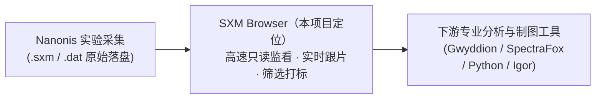
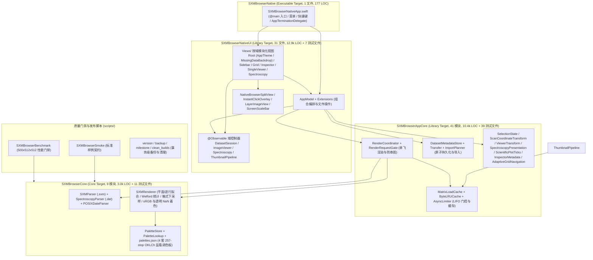
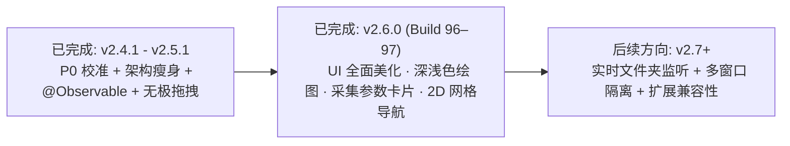

# SXM Browser 项目进展评估与演进规划报告

当前基准：`main` 分支（`v2.6.1`，Build 98，已完成原生 UI 全面美化、Dark/Light 科研绘图适配、AFM `Δf` 原始极值视窗、DAT 重复列名修复与双端同步）。  
实测验证：全量 **322 项自动化测试通过**（[`SXMBrowserCoreTests`](native/SXMBrowserNative/Tests/SXMBrowserCoreTests) 70 项 + [`SXMBrowserAppCoreTests`](native/SXMBrowserNative/Tests/SXMBrowserAppCoreTests) 239 项 + [`SXMBrowserNativeUITests`](native/SXMBrowserNative/Tests/SXMBrowserNativeUITests) 13 项），标准样例（6 个 `.sxm` + 18 个 `.dat`，0 问题）[`SXMBrowserSmoke`](native/SXMBrowserNative/Sources/SXMBrowserSmoke/main.swift#L1-L473) 契约校验与 500×512×512 性能门禁（中位数 `scan 28.049 ms / image 20.741 ms / thumbnail 21.570 ms`）全部通过。

---

## 一、产品定位与核心准则（Product Positioning）

### 1.1 核心定位：纯粹的原生高速数据监看器（Pure Data Monitor）

**SXM Browser** 定位为专注 Nanonis 扫描探针显微实验数据（`.sxm` 扫描图与 `.dat` 点谱）的 **macOS 原生高速只读数据监看与分拣工具**——类似摄影工作流中的 Raw 样片监看台（Photo Mechanic 角色）：服务于实验人员在机台旁实时看片、快速核对物理采集参数、高保真预览原始形貌与谱线，以及高效筛选打标归档。

### 1.2 明确边界：有所为，有所不为（Non-Goals）

> [!IMPORTANT]
> 为保持代码精简、启动与切图极致轻快、界面纯粹无干扰，项目明确划定以下边界：
> - **不负责论文级排版出图**：不做烧录比例尺、Colorbar 色条、字体标注或谱点叠加的排版合成面板，不做 PDF/SVG/DPI 出版级制图导出（仅保留纯净像素级 sRGB PNG 快速导出供即时沟通）。
> - **不负责修图与重度科学后处理**：不做去划痕（Scar removal）、任意多项式背景修平、2D FFT 滤波与倒空间测量、任意方向高度截线（Line Profile）测量、Savitzky–Golay 平滑或数值微分分峰。
> - **绝不改写原始实验数据**：所有显示增强（如 `Plane linear fit`、`Subtract linear fit`、色阶拉伸）均为内存态实时监看滤镜，原始 `.sxm` / `.dat` 文件保持 100% 只读（仅支持用户显式确认移入系统废纸篓）。

### 1.3 三大演进目标支柱

后续全部开发工作严格收敛并落实到以下三个维度：

1. **数据可靠性（Data Reliability）**：空间方向、物理通道语义与色彩还原零失真；异常/停扫/截断文件安全兜底不崩溃；目录动态变化与元数据持久化严谨无损。
2. **程序性能优化（Performance & Responsiveness）**：消除全局无效重绘与冗余内存驻留；千级文件目录秒级检索、视口缩略图即时出图、单击与分栏拖拽零延迟跟手。
3. **UI 全面美观（Comprehensive UI Aesthetics）**：贯彻 macOS 14+ 原生视觉体系，画面留白克制、信息层级清晰、深浅色模式和谐、微交互细腻统一。

---

## 二、架构基线与已完成项目（Completed Progress）

### 2.1 当前总体架构基线

项目已稳定运行于 **纯原生 macOS 14+ 架构（Swift 6.0 + SwiftUI/AppKit + CoreAnimation + `@Observable`）**，Swift 源码与自动化测试总计 **41,517 行**（涵盖 4 个核心模块、2 个验收工具与 57 个测试文件 / 322 项测试）：

**已沉淀的核心技术资产**：
- **数值精度保障**：[`planeLinearFit`](native/SXMBrowserNative/Sources/SXMBrowserCore/SXMRender.swift) 与 [`lineLinearFit`](native/SXMBrowserNative/Sources/SXMBrowserCore/SXMRender.swift) 采用坐标归一化与 `Double` 中心化正规方程求解，保留大压电偏置下皮米级原子台阶残差；`statistics` 基于 Welford 在线算法复用统计量。
- **异步防串图与原子存储**：[`RenderCoordinator`](native/SXMBrowserNative/Sources/SXMBrowserAppCore/RenderCoordinator.swift) + [`RenderRequestGate`](native/SXMBrowserNative/Sources/SXMBrowserAppCore/RenderRequestGate.swift) 严格拦截跨数据集/跨文件迟到帧；[`DatasetMetadataStore`](native/SXMBrowserNative/Sources/SXMBrowserAppCore/DatasetMetadataStore.swift) 具备原子写、逐字节读回校验与损坏文件保护。
- **高辨识度科学监看色标**：在 OKLab/OKLCh 感知均匀空间构建并用 SHA-256 指纹锁死 4 套 257-stop 监看调色板（`Dusk Violet`、`Ink Violet`、`Ember`、`Basic gray`）。
- **细粒度 `@Observable` 响应式编排**：[`SXMBrowserNativeUI`](native/SXMBrowserNative/Sources/SXMBrowserNativeUI/Controllers/AppModel.swift) 通过域控制器隔离状态更新、版本化缓存派生列表、`InstantClickOverlay` 零延迟派发与 LIFO 视口优先缩略图限流，支撑千级文件目录流畅交互。
- **深浅色科研绘图与结构化参数视窗（`v2.6.0`）**：[`ScientificPlotTicks`](native/SXMBrowserNative/Sources/SXMBrowserAppCore/ScientificPlotTicks.swift) 计算 `1-2-5` 刻度与紧凑科学标签，配合 [`AppTheme`](native/SXMBrowserNative/Sources/SXMBrowserNativeUI/Views/Root/AppTheme.swift) 与 `MissingDataBackdrop` 在单图/缩略图清晰呈现 `NaN` 停扫底板；[`InspectorMetadataPresentation`](native/SXMBrowserNative/Sources/SXMBrowserAppCore/InspectorMetadata.swift) 结构化解析偏压、反馈状态、Setpoint、扫描速度与可检索 `Raw Header`，并由 [`AdaptiveGridNavigation`](native/SXMBrowserNative/Sources/SXMBrowserAppCore/AdaptiveGridLayout.swift) 保障 `.sxm`/`.dat` 混排网格的真实二维方向键导航。

### 2.2 阶段零（`v2.4.1`–`v2.4.2`）已完成项目清单

截至 Build 93，**原审查报告中的全部 P0 缺陷（5/5）及基础可靠性优化均已交付验收**：

| 原编号 | 类别 | 已完成内容与代码落点 | 完成版本 |
| :--- | :--- | :--- | :--- |
| **D1 (P0)** | 数据可靠性 | **`:SCAN_DIR: up` 空间手性校准**：[`SXMParser.swift`](native/SXMBrowserNative/Sources/SXMBrowserCore/SXMParser.swift) 解码阶段将向上扫描归一化为物理 `+Y` 朝上；[`SXMModels.swift`](native/SXMBrowserNative/Sources/SXMBrowserCore/SXMModels.swift) 改为精确词元匹配；同步统一 [`ScanCoordinateTransform`](native/SXMBrowserNative/Sources/SXMBrowserAppCore/ScanCoordinateTransform.swift) Y 轴映射并补齐回归测试 | `v2.4.1` (Build 92) |
| **D2 (P0)** | 数据可靠性 | **物理通道分类与默认处理校准**：[`SXMModels.swift`](native/SXMBrowserNative/Sources/SXMBrowserCore/SXMModels.swift) 细分为 `.topography` / `.conductanceOrCurrent` / `.afm`，仅形貌高度通道（`Z` / `Height` / `Topography`）默认 `.planeLinear`，电导/电流与 AFM 保持 `.raw`，消除人为梯度伪影 | `v2.4.1` (Build 92) |
| **D3 (P0)** | 可靠性 / 性能 | **全链路显式 sRGB 与线程安全缩略图缩放**：[`SXMRender.swift`](native/SXMBrowserNative/Sources/SXMBrowserCore/SXMRender.swift) 统一绑定 `CGColorSpace.sRGB`，PNG 直出 `NSBitmapImageRep(cgImage:)`；移除后台 `NSImage.lockFocus()`，改为有限值箱式下采样 `downsampleMatrix` + `CGContext` 缩放 | `v2.4.1` (Build 92) |
| **D4 (P0)** | UI 交互 | **`ScaleField` 缓冲输入与 SI 工程后缀解析**：[`InspectorView.swift`](native/SXMBrowserNative/Sources/SXMBrowserNativeUI/Views/Inspector/InspectorView.swift) 采用 `@FocusState` + `draftText` 隔离输入态，提交/失焦时通过 [`SpectroscopyParser.swift`](native/SXMBrowserNative/Sources/SXMBrowserCore/SpectroscopyParser.swift) `parseEngineeringDouble` 解析 `p`/`n`/`u`/`m` 等后缀与科学计数法 | `v2.4.1` (Build 92) |
| **D5 (P0)** | UI 交互 | **应用内右键 `Open` 与 `Cmd+A` 焦点分流**：右键 `Open` 改为应用内选中并切至 Single 视图；[`AppModel+TagsAndDeletion.swift`](native/SXMBrowserNative/Sources/SXMBrowserNativeUI/Controllers/AppModel+TagsAndDeletion.swift) `selectAll` 识别 `NSText` 第一响应者优先全选输入框文本 | `v2.4.1` (Build 92) |
| **D6 局部** | 性能优化 | **空搜索词短路优化**：[`DatasetSessionController.swift`](native/SXMBrowserNative/Sources/SXMBrowserNativeUI/Controllers/DatasetSessionController.swift) 在搜索词为空时直接返回候选集，消除无搜索时的 `O(F × S)` 谱图关联遍历 | `v2.4.1` (Build 92) |
| **D7 局部 (P1)** | 性能 / 并发 | **`AsyncLimiter` 取消安全与缩略图失效完善**：重构 [`AsyncLimiter.swift`](native/SXMBrowserNative/Sources/SXMBrowserAppCore/AsyncLimiter.swift) 消除取消早于入队的挂起竞态；[`ThumbnailPipeline.swift`](native/SXMBrowserNative/Sources/SXMBrowserNativeUI/Controllers/ThumbnailPipeline.swift) 支持多等待者引用计数取消传播及 `modifiedTime` 缓存键失效 | `v2.4.1` (Build 92) |
| **D8 (P1)** | 可靠性 / 性能 | **`.dat` 大文件/二进制护栏与日期解析缓存**：[`SpectroscopyParser.swift`](native/SXMBrowserNative/Sources/SXMBrowserCore/SpectroscopyParser.swift) 增加 64 MiB 上限与 256 KiB 头部预检（拦截二进制 NUL 与无 `[DATA]` 文件）；新增锁保护的 [`POSIXDateParser.swift`](native/SXMBrowserNative/Sources/SXMBrowserCore/POSIXDateParser.swift) 复用 `DateFormatter` | `v2.4.1` (Build 92) |
| **D10 局部** | UI 美观 / 可靠 | **画布滤波、比例尺阴影、光标栈与删除元数据清理**：`LayerImageView` 启用 `.linear` 缩小滤波消除摩尔纹；`ScreenScaleBar` 增加双层暗色阴影适配亮底；`CursorModifier` 在 `onDisappear` 自动平衡 `NSCursor` 栈；批量删文件合并清缓存并同步清理孤儿 `manualAssociations` 与 `spectrumAxisPreferences` | `v2.4.1` (Build 92) |
| **D11 & D13** | 工程卫生 | **构建缓存治理与文档/分支同步**：新增 [`clean_builds.command`](scripts/clean_builds.command) 清空历史 `.build*` 缓存目录；补齐 [`test_all.command`](scripts/test_all.command) 缓存环境变量；同步更新 [README.md](README.md) | `v2.4.1`–`v2.4.2` |
| **色标精炼** | UI 美观 | **新增 `Ember` 暖铜调色板并收敛色标库**：引入符合经典 STM 审美语汇的 `Ember`（257-stop OKLCh），退役旧 `Flame` 与 `Deep Blue` 并平滑回退历史偏好 | `v2.4.2` (Build 93) |

### 2.3 阶段一（`v2.5.0` / Build 94）架构瘦身与极致性能打磨已完成项目

截至 Build 94，**架构瘦身、内存减半、`@Observable` 模块解耦与极速网格交互全部完成交付**：

| 原编号 | 类别 | 已完成内容与代码落点 | 完成版本 |
| :--- | :--- | :--- | :--- |
| **D9** | 性能 / 瘦身 | **清退死代码并减少 50% 活动大图矩阵内存**：移除 [`RenderCoordinator.swift`](native/SXMBrowserNative/Sources/SXMBrowserAppCore/RenderCoordinator.swift) 中 `ProcessedPayload.source` 与 `ProbePixelValues`，删除废弃文件 `ProbeReading.swift`、`ResponsivePaneLayout.swift` 及残留 `probeReading` / `manuallyAssignedSXMIDBySpectrumID` / `manualTargetPathByDATPath` 状态；抽出 [`ScanCoordinateTransform.swift`](native/SXMBrowserNative/Sources/SXMBrowserAppCore/ScanCoordinateTransform.swift) 专职服务 `.dat` 测量坐标映射 | `v2.5.0` (Build 94) |
| **D6 & D12** | 架构 / 性能 | **模块拆分、`@Observable` 域控制器与派生列表缓存**：通过 [`Package.swift`](native/SXMBrowserNative/Package.swift) 将 UI 编排拆入 `SXMBrowserNativeUI`（保留极薄 `@main` 入口 [`SXMBrowserNativeApp.swift`](native/SXMBrowserNative/Sources/SXMBrowserNative/SXMBrowserNativeApp.swift)）并新增 `@MainActor` 测试目标 [`SXMBrowserNativeUITests`](native/SXMBrowserNative/Tests/SXMBrowserNativeUITests)；将 `AppModel` 迁移为 macOS 14 `@Observable` 组合 [`DatasetSessionController`](native/SXMBrowserNative/Sources/SXMBrowserNativeUI/Controllers/DatasetSessionController.swift)、[`ImageViewerController`](native/SXMBrowserNative/Sources/SXMBrowserNativeUI/Controllers/ImageViewerController.swift)、[`SpectroscopyController`](native/SXMBrowserNative/Sources/SXMBrowserNativeUI/Controllers/SpectroscopyController.swift) 与 [`ThumbnailPipeline`](native/SXMBrowserNative/Sources/SXMBrowserNativeUI/Controllers/ThumbnailPipeline.swift)；为 `sortedFiles` / `visibleFiles` / `visibleDisplayItems` / `files(forTagID:)` 建立版本号驱动 O(1) 缓存；将原 `Views.swift` 拆分为 `Views/{Root,Sidebar,Grid,Inspector,SingleViewer,Spectroscopy}/` 并抽出 `SidebarStatusFooter` | `v2.5.0` (Build 94) |
| **D7 & D10** | 并发 / 交互 | **视口优先缩略图调度、零延迟单击与后台废纸篓清理**：[`AsyncLimiter.swift`](native/SXMBrowserNative/Sources/SXMBrowserAppCore/AsyncLimiter.swift) 新增 `.lifo` 排队模式并在 [`ThumbnailPipeline.swift`](native/SXMBrowserNative/Sources/SXMBrowserNativeUI/Controllers/ThumbnailPipeline.swift) 启用（`limit: 4, order: .lifo`）；[`ThumbnailCard.swift`](native/SXMBrowserNative/Sources/SXMBrowserNativeUI/Views/Grid/ThumbnailCard.swift) 采用 AppKit [`InstantClickOverlay.swift`](native/SXMBrowserNative/Sources/SXMBrowserNativeUI/Views/Grid/InstantClickOverlay.swift) (`GridCardClickAction.resolve`) 消除双击判定导致的 `~250ms` 单击迟滞；[`AppModel+TagsAndDeletion.swift`](native/SXMBrowserNative/Sources/SXMBrowserNativeUI/Controllers/AppModel+TagsAndDeletion.swift) 将 `FileManager.default.trashItem` 移至后台执行并引入 `isDeletingFiles` 并发忙锁与跨会话防护 | `v2.5.0` (Build 94) |

### 2.4 阶段一收官与阶段二（`v2.5.1`–`v2.6.0`）已完成项目清单

截至 Build 97，**无极直方图拖拽、关窗退出、Dark/Light 科学绘图、`NaN` 停扫底板、Inspector 参数卡片、2D 网格导航、主分支合入与系统应用同步均已交付验收**：

| 类别 | 已完成内容与代码落点 | 完成版本 |
| :--- | :--- | :--- |
| **生命周期与无极色阶** | 新增 `@MainActor AppTerminationDelegate` 实现关窗即退；[`ImageViewerController.swift`](native/SXMBrowserNative/Sources/SXMBrowserNativeUI/Controllers/ImageViewerController.swift) `updateScale(min:max:)` 采用同矩阵原地保帧与单飞合并调度，[`PaletteStore.swift`](native/SXMBrowserNative/Sources/SXMBrowserCore/PaletteStore.swift) 提供 `PaletteLookup` O(1) 均匀查表着色与 `Gradient` 色条重绘 | `v2.5.1` (Build 95) |
| **深浅色主题与 `NaN` 棋盘底板** | [`AppTheme.swift`](native/SXMBrowserNative/Sources/SXMBrowserNativeUI/Views/Root/AppTheme.swift) 定义深浅色面板/网格/直方图颜色令牌与 `MissingDataBackdrop`；[`SXMModels.swift`](native/SXMBrowserNative/Sources/SXMBrowserCore/SXMModels.swift) 与 [`SXMRender.swift`](native/SXMBrowserNative/Sources/SXMBrowserCore/SXMRender.swift) 新增 `transparentMissingValues`（单图与缩略图呈现透明棋盘格，PNG 导出保持不透明 sRGB） | `v2.6.0` (Build 96) |
| **科学绘图、直方图与比例尺** | 新增 [`ScientificPlotTicks.swift`](native/SXMBrowserNative/Sources/SXMBrowserAppCore/ScientificPlotTicks.swift) 计算 `1-2-5` 刻度，[`SpectroscopyPlotView.swift`](native/SXMBrowserNative/Sources/SXMBrowserNativeUI/Views/Spectroscopy/SpectroscopyPlotView.swift) 与 [`HistogramView.swift`](native/SXMBrowserNative/Sources/SXMBrowserNativeUI/Views/Inspector/HistogramView.swift) 适配深浅色模式及 7 号槽对比度替代色；[`PaletteStrip.swift`](native/SXMBrowserNative/Sources/SXMBrowserNativeUI/Views/Inspector/PaletteStrip.swift) 改为 `LinearGradient`，[`ScreenScaleBar.swift`](native/SXMBrowserNative/Sources/SXMBrowserNativeUI/Views/SingleViewer/ScreenScaleBar.swift) 增加端线与对比描边 | `v2.6.0` (Build 96) |
| **Inspector 参数卡片与可检索 Header** | [`InspectorMetadata.swift`](native/SXMBrowserNative/Sources/SXMBrowserAppCore/InspectorMetadata.swift) 结构化解析偏压、反馈状态、Setpoint、扫描速度、温度、耗时与备注；[`InspectorView.swift`](native/SXMBrowserNative/Sources/SXMBrowserNativeUI/Views/Inspector/InspectorView.swift) 展示 `Acquisition & File` 2×3 卡片、可搜索 `Raw Header` 折叠区及网格模式紧凑提示条 | `v2.6.0` (Build 96) |
| **2D 混排网格导航与图例同步** | [`AdaptiveGridLayout.swift`](native/SXMBrowserNative/Sources/SXMBrowserAppCore/AdaptiveGridLayout.swift) 新增 `AdaptiveGridNavigation.targetFileID` 并接入 `AppModel.moveSelectionForArrow` 保障 `.sxm`/`.dat` 混排网格二维方向键导航；[`SingleSpectroscopyDrawer.swift`](native/SXMBrowserNative/Sources/SXMBrowserNativeUI/Views/SingleViewer/SingleSpectroscopyDrawer.swift) 修复 `SpectroscopyLegend.==` | `v2.6.0` (Build 96) |
| **分支合入与系统应用同步** | 将 `codex/sxm-ui-2.6` 快进合入 `main` 分支，同步 `README.md` / `ROADMAP.md` 架构行数基线，将签名后的 `2.6.0`（Build 97）安装至 `/Applications/SXM Browser.app` 并保留 `v2.5.1`（Build 95）备份链路 | `v2.6.0` (Build 97) |

---

## 三、现存待优化项盘点（Remaining Debt）

结合“纯粹数据监看器”定位，阶段一完成后代码库中仅余以下待推进至后续版本的功能与体验细节：

| 归属支柱 | 原编号 | 模块 | 现存问题描述 | 处理策略 |
| :--- | :--- | :--- | :--- | :--- |
| **数据可靠性** | **D10 / D12** | `SpectroscopyController` / `SXMBrowserNativeApp` | 缺少 UI 入口解除/重置 `.dat` 手动关联（`.missingManualTarget` 状态无处恢复）；`WindowGroup` 共享会话缺乏多窗口隔离 | 在 `v2.7` 实时监听与多窗口迭代中补齐 |

> [!NOTE]
> 以下 `v2.5` UI 交互遗留问题已在 **`v2.6.0` (Build 96)** 中完成交付：自适应深浅色科学绘图与 `1-2-5` 刻度（`ScientificPlotTicks`）、单图与缩略图 `NaN` 未采集区域透明棋盘底板、Inspector 结构化物理采集参数卡片与可检索 `Raw Header`、混排网格真实二维方向键导航（`AdaptiveGridNavigation.targetFileID`），以及 `SpectroscopyLegend.==` 基于 ID 列表与焦点状态的精确刷新同步。

---

## 四、后续演进路线图（Roadmap）

摒弃复杂的修图、测量与排版导出包袱后，后续版本聚焦 **“更快、更稳、更好看”** 三阶段递进：

---

### 阶段一：`v2.5` 架构瘦身与极致性能打磨（已完成：`v2.5.0` Build 94 → `v2.5.1` Build 95）

让应用在承载 **1,000+ 文件实验目录** 时依然保持零掉帧、低内存占用与瞬时点选响应：

- [x] **清退死代码并释放双倍矩阵内存（解决 D9）**
  - 移除 `RenderCoordinator.ProcessedPayload.source`、`ProbePixelValues`、`ProbeReading`、`PixelCoordinate`、`ResponsivePaneLayout` 及 `AppModel` 残留 `probeReading` / `manuallyAssignedSXMIDBySpectrumID` / `manualTargetPathByDATPath` 状态，抽出 `ScanCoordinateTransform` 并降低 **50%** 活动大图矩阵常驻内存。
- [x] **`@Observable` 细粒度状态架构与模块解耦（解决 D6 & D12）**
  - 将 `SXMBrowserNative` 拆分为极薄 `@main` 入口 + `SXMBrowserNativeUI` 库 Target，建立 `SXMBrowserNativeUITests` 单元测试目标。
  - 利用 macOS 14 原生 `@Observable` 宏将 `AppModel` 拆解为职责单一的域控制器（`DatasetSessionController`、`ImageViewerController`、`SpectroscopyController`、`ThumbnailPipeline`），消除跨领域无效重绘。
  - 为 `sortedFiles`、`visibleFiles`、`visibleDisplayItems` 与 `files(forTagID:)` 建立数据版本号驱动的 O(1) 派生缓存。
  - 将原 `Views.swift` 按视图域拆分为 `Root/`、`Sidebar/`、`Grid/`、`SingleViewer/`、`Spectroscopy/`、`Inspector/` 并抽出 `SidebarStatusFooter`。
- [x] **海量网格与文件操作极速响应（深化 D7 & D10）**
  - **视口优先缩略图调度（LIFO / Viewport Priority）**：`AsyncLimiter` 支持 `.lifo` 且 `ThumbnailPipeline` 默认启用。
  - **零延迟单击选中**：通过 AppKit `InstantClickOverlay` (`GridCardClickAction`) 替代双层 `TapGesture`，实现单击立即选中与双击进入 Single 视图。
  - **异步废纸篓清理**：`performDeleteFiles` 将 `FileManager.default.trashItem` 下放至后台执行，并加入 `isDeletingFiles` 并发忙锁及跨会话清理防护。
- [x] **无极直方图拖拽刷新与单窗退出生命周期优化（`v2.5.1`, Build 95）**
  - **关窗即退出**：通过 `@MainActor AppTerminationDelegate`（`NSApplicationDelegate.applicationShouldTerminateAfterLastWindowClosed(_:)`）与 `@NSApplicationDelegateAdaptor` 挂载到 [`SXMBrowserNativeApp`](native/SXMBrowserNative/Sources/SXMBrowserNative/SXMBrowserNativeApp.swift)，关闭最后一个窗口时直接退出应用，不在 Dock 栏残留。
  - **无极实时拖拽色阶**：移除 `updateScale(min:max:)` 的 70 ms 取消重睡防抖，改用同矩阵（`processedKey` 未变）原地保留 `renderedFrame` / `selectedStats`（消除 `"Rendering..."` 闪烁与拖拽手势中断）+ 零等待单飞合并调度（`inFlightCoalescedRequestID` / `hasPendingScaleRender`）+ [`PaletteLookup`](native/SXMBrowserNative/Sources/SXMBrowserCore/PaletteStore.swift) O(1) 均匀网格查表着色与 `Gradient` 色条重绘。

---

### 阶段二：`v2.6.0` UI 全面美化、科学绘图适配与交互细节完成情况（`v2.6.0` Build 96–97，已完成）

- [x] **Dark/Light 自适应设计令牌与 `NaN` 停扫底板**：[`AppTheme.swift`](native/SXMBrowserNative/Sources/SXMBrowserNativeUI/Views/Root/AppTheme.swift) 引入统一的深浅色绘图与卡片表面色板、`MissingDataBackdrop` 细格棋盘及 SI/扫描范围/耗时格式化；`RenderOptions.transparentMissingValues` 在交互缩略图与单图画布中将非有限像素渲染为透明，纯净 PNG 导出保持不透明。
- [x] **谱图画布、直方图与比例尺升级**：新增 [`ScientificPlotTicks.swift`](native/SXMBrowserNative/Sources/SXMBrowserAppCore/ScientificPlotTicks.swift) 计算 `1-2-5` 刻度与紧凑科学标签，[`SpectroscopyPlotView.swift`](native/SXMBrowserNative/Sources/SXMBrowserNativeUI/Views/Spectroscopy/SpectroscopyPlotView.swift) 与 [`HistogramView.swift`](native/SXMBrowserNative/Sources/SXMBrowserNativeUI/Views/Inspector/HistogramView.swift) 全面适配深浅色模式及调色板 7 号槽高对比替代色；[`ScreenScaleBar.swift`](native/SXMBrowserNative/Sources/SXMBrowserNativeUI/Views/SingleViewer/ScreenScaleBar.swift) 与 [`PaletteStrip.swift`](native/SXMBrowserNative/Sources/SXMBrowserNativeUI/Views/Inspector/PaletteStrip.swift) 完成精修。
- [x] **Inspector 采集参数卡片与可检索 `Raw Header`**：[`InspectorMetadata.swift`](native/SXMBrowserNative/Sources/SXMBrowserAppCore/InspectorMetadata.swift) 结构化解析偏压、反馈状态、Setpoint、温度、扫速、耗时与备注，[`InspectorView.swift`](native/SXMBrowserNative/Sources/SXMBrowserNativeUI/Views/Inspector/InspectorView.swift) 采用 2×3 物理指标卡片、可搜索 `Raw Header` 折叠区及网格模式紧凑提示条。
- [x] **混排网格二维键盘导航与图例判等修复**：[`AdaptiveGridLayout.swift`](native/SXMBrowserNative/Sources/SXMBrowserAppCore/AdaptiveGridLayout.swift) 新增 `AdaptiveGridNavigation.targetFileID`，[`SingleSpectroscopyDrawer.swift`](native/SXMBrowserNative/Sources/SXMBrowserNativeUI/Views/SingleViewer/SingleSpectroscopyDrawer.swift) 修复 `SpectroscopyLegend.==` 对比可见/全部 ID 与焦点状态。

### 阶段三（后续方向）：实时监听与多窗口/系统集成（规划中）

1. **实验文件夹实时安全监听（Live Folder Watch）与只读兼容性拓展**
   - 监听工作目录增量变化、半写保护（Write-in-progress Guard）、`Cmd+R` 刷新、通道/色阶锁定，以及按需扩展 `FLOAT LSBFIRST` 与系统 UTI / Quick Look（不在本次 `v2.6.0` 范围内）。
